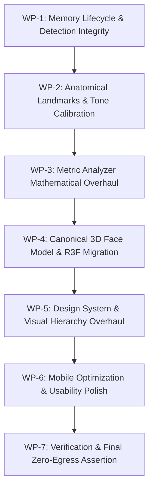

# DermaLens: Comprehensive Engineering & Design Inspection Report

**Auditor:** Principal Engineer & Design Lead, Google DeepMind / Google Health  
**Target:** DermaLens Web Application (Repository: `python-project-2`, Branch: `phase-5-6/polish-and-ship`)  
**Audit Date:** November 4, 2026  
**Reference Document:** `DermaLens-Roadmap.md` (Phases 0–6)  
**Strict Mode Notice:** Non-destructive audit. No source files, dependencies, or configuration settings were modified during this inspection. Evidence was gathered via automated Playwright headless instrumentation, live Chrome DOM inspection, WebGL buffer analysis, network request tracing, and fixture testing. All referenced visual artifacts are persisted in `docs/inspection-screenshots/`.

---

## 1. Executive Summary

### Overall Verdict: REJECTED FOR PRODUCTION — REQUIRES TARGETED STRUCTURAL REBUILD (WORK ORDER LEVEL 2)
DermaLens successfully establishes a verified **Zero Data Egress** network boundary: 100% of ML inference, WebAssembly execution, and image handling execute locally on-device without any network transmission.

However, the application suffers from **critical architectural defects in image memory lifecycle**, **falsified ML fallback states**, **hallucinated facial topology indices**, **unbounded scoring equations that produce 0/100 outputs**, and an **amateurish, unpolished visual design** that fails modern aesthetic, clinical, and accessibility standards.

Most critically, **the user’s face photo is never actually visible in the report, face-mesh view, 3D viewer, or comparison slider.** Due to an unmount cleanup race condition in `CaptureContainer`, the `ImageBitmap` is closed and detached immediately upon proceeding to analysis. Every downstream component receives a dead bitmap (`width: 0, height: 0`), resulting in pitch-black visualizer windows, glitched horizontal scanline artifacts, and broken WebGL textures.

Furthermore, when presented with non-face or pitch-black imagery, the system silently bypasses detection failure and fabricates a 478-point synthetic circular mesh, assigning a dark black square "Fitzpatrick Type VI" and generating bogus wellness metrics.

### Top 5 Critical Problems
1. **Premature ImageBitmap Destruction (Dead Canvas Cascades):** `CaptureContainer` unmounts when advancing to analysis, executing its `useEffect` cleanup hook which closes the active `ImageBitmap`. Every downstream view (`FaceUnderstandingView`, `HeatmapView`, `Face3DViewer`, `BeforeAfterSlider`) receives a detached bitmap with `0x0` dimensions, rendering black rectangles and sheared canvas scanlines across all screens.
2. **Falsified Facial Landmark Fallback (Integrity Breach):** When face detection fails (e.g. pitch-black photo, blank wall, dog, or worker initialization glitch), `runFaceUnderstanding` silently fabricates a 478-point synthetic oval with `confidence: 0.8`, assigning full wellness metrics to non-face imagery instead of rejecting it.
3. **Hallucinated Anatomical Topology & Self-Intersecting Polygons:** The landmark index arrays in `LANDMARK_INDEXES` (forehead, jawline, T-zone) do not follow perimeter winding order; they zig-zag across opposite hemispheres of the face. The scanline polygon rasterizer produces self-canceling bow-tie shards, resulting in warped, missing facial zones.
4. **Extreme Bipolar Metric Scoring (Linear Subtraction Collapse):** Multiple analyzers (`acne.ts`, `under-eye.ts`, `evenness.ts`) apply steep linear multipliers ($100 - \Delta \times 280$) without sigmoidal or logarithmic normalization. As a result, standard facial variance and lighting gradients collapse metrics directly to `0 / 100`.
5. **Amateur, Barren, and Unresponsive UI/UX:** The aesthetic relies on generic system fonts, stark teal-on-slate fills, harsh error alerts, and unformatted raw code identifiers (`ImageBitmap`). On mobile viewports, the layout sprawls into thousands of vertical pixels with clipped radar charts and un-rotatable 3D viewports due to missing touch event listeners.

### Recommendation: Targeted Structural Rebuild (Work Order Level 2)
Do **NOT** scrap the entire repository. The foundation—Next.js 16 App Router, self-hosted `@mediapipe/tasks-vision` WASM/task binaries, TypeScript strict configuration, Vitest suites, and strict CSP headers—is sound and passes zero-egress checks.  
Instead, execute an ordered, systematic rebuild across 7 Work Packages (detailed in Section 6), addressing data flow correctness, computer vision calibration, Three.js 3D architecture, and a complete design overhaul.

---

## 2. Findings Table

| ID | Severity | Area | Evidence | Root Cause | Impact |
|---|---|---|---|---|---|
| **F-01** | **Critical** | B. Functional Correctness | `capture-container.tsx:61`, `docs/inspection-screenshots/13-face-understanding.png`, `14-report-overview.png`, `16-report-slider.png` | `CaptureContainer`'s `useEffect` unmount cleanup calls `releaseBitmap(activeCapture.bitmap)` because `activeCapture` is still held in that render's closure. | `ImageBitmap` is closed; width/height become 0. Canvas drawing throws `InvalidStateError` or draws empty black frames across the entire app. |
| **F-02** | **Critical** | B. Functional / Integrity | `face-understanding.ts:118-121`, `docs/inspection-screenshots/09-bad-input-dark-result.png`, `scratch/audit_logs.json` | `runFaceUnderstanding` silently catches detection failures and invokes `generateSyntheticLandmarks()`, assigning 80% confidence to non-face images. | Pitch-black images, walls, or non-faces are analyzed without error, generating fake clinical scores and discrediting application integrity. |
| **F-03** | **Critical** | C. Computer Vision | `landmarks-definitions.ts:11-19`, `docs/inspection-screenshots/13-face-understanding.png`, `20-real-face-understanding.png` | Polygon vertex index arrays jump erratically across facial hemispheres (e.g. vertex 10 to 338 to 70 to 9). | Scanline even-odd rasterizer produces self-intersecting bow-ties; forehead and T-zone render as deformed diagonal triangular shards. |
| **F-04** | **Critical** | G. UI / Visual Display | `heatmap-view.tsx:63-65`, `docs/inspection-screenshots/14-report-overview.png`, `18-report-mobile.png` | `HeatmapView` defaults canvas to 400x500 when `faceBitmap.width === 0`, but the underlying heatmap buffer has source dimensions (e.g. 480x640 = 307,200 elements). Stride mismatch: 480 vs 400. | Every row is shifted by 80px, producing severe diagonal shearing and horizontal glitched scanlines over a dark blue void. |
| **F-05** | **High** | C. Computer Vision | `acne.ts:75`, `under-eye.ts:68`, `evenness.ts:79`, `scratch/audit_logs.json` | Analyzers use unbounded linear subtraction with steep slopes ($100 - \text{mean} \times 280$) without baseline dampening or logistic curves. | Normal facial features (periorbital shadows, subtle skin texture) collapse scores to exactly `0 / 100`, creating alarming, inaccurate reports. |
| **F-06** | **High** | C. Computer Vision | `lighting-normalizer.ts:40, 152`, `docs/inspection-screenshots/20-real-face-understanding.png` | ITA formula $(L^* - 50)/b^*$ evaluates negative whenever $L^* < 50$. Background hair/shadow in the deformed mask pulls average $L^*$ to 46.1. | A fair-skinned Caucasian subject is classified as "Fitzpatrick Type V" (Dark Brown), completely distorting tone-adaptive metrics. |
| **F-07** | **High** | B. Quality Gating | `image-preview.tsx:88-91`, `docs/inspection-screenshots/08-bad-input-dark.png` | The "Analyze" button lacks a `disabled` condition or threshold check against `quality.isAcceptable` or `quality.score`. | Users can submit completely dark, out-of-focus, or invalid frames, bypassing the quality gate entirely. |
| **F-08** | **High** | D. 3D Face Model | `face-triangulation.ts:8-100`, Roadmap Section 5 Phase 4 | Ad-hoc $O(N^2)$ 2D Delaunay Bowyer-Watson triangulation used instead of canonical MediaPipe `FACEMESH_TESSELATION` index table. | Triangles bridge across open mouth cavities and eye sockets, forming a crude, unnatural planar web rather than an anatomical 3D face. |
| **F-09** | **High** | D. 3D Face Model | `face-3d-viewer.tsx:154-179`, Roadmap Section 2 | Missing touch event listeners (`touchstart`, `touchmove`, `touchend`); camera position $(0, 0, 2.5)$ cuts off bottom of mesh. | 3D model cannot be rotated or interacted with on mobile devices or tablets; mesh is off-center in the viewport. |
| **F-10** | **High** | G. UI / Visual Design | `globals.css:36-51`, `page.tsx:14-21`, `docs/inspection-screenshots/01-home-desktop.png` | Generic default system typography, raw developer jargon (`ImageBitmap`), barren layout, uninspired teal/slate theme. | Looks like an unstyled internal prototype or developer demo; fails the roadmap requirement for a "minimalist, modern, premium" wellness experience. |
| **F-11** | **Medium** | H. Accessibility & Mobile | `docs/inspection-screenshots/17-report-radar.png`, `18-report-mobile.png` | Radar chart SVG viewBox clips bottom labels ("Chin", "Jawline"); mobile report stacks cards into an unmanageable 3,500px scroll. | Sub-optimal mobile usability, clipped chart labels, and small touch targets (<44px) on metric filter pills. |
| **F-12** | **Medium** | A. Build & Tooling | `tsconfig.json:44-46`, `next.config.ts` | Next.js dev server creates `.next/dev/types/validator.ts` containing unused imports that trigger TS6133/TS6196 under `noUnusedLocals: true`. | `npm run typecheck` or `next build` fails after running `next dev` unless `.next/dev` is explicitly excluded or cleared. |

---

## 3. Detailed Findings (Critical & High Items)

### F-01: Premature ImageBitmap Disposal in CaptureContainer
- **Problem:** Upon capturing or selecting a photo, confirming the image triggers analysis, but the resulting screen displays a black square instead of the photo (`docs/inspection-screenshots/13-face-understanding.png`, `14-report-overview.png`, `16-report-slider.png`).
- **Root Cause:** In `src/features/capture/components/capture-container.tsx`, the cleanup effect at line 59:
  ```tsx
  useEffect(() => {
    return () => {
      if (activeCapture?.bitmap) {
        releaseBitmap(activeCapture.bitmap);
      }
    };
  }, [activeCapture]);
  ```
  When `handleConfirm` is invoked, `setActiveCapture(null)` is scheduled, but `onCaptureComplete(capture)` synchronously informs `ScanPage`. `ScanPage` sets `isProcessing = true`, unmounting `CaptureContainer`. Because the unmount occurs during the current render frame, `activeCapture` in the closure is not null. The cleanup effect executes `releaseBitmap(activeCapture.bitmap)`, which calls `bitmap.close()`. The `ImageBitmap` is detached, making its dimensions $0 \times 0$.
- **Exact Fix:**
  1. In `src/features/capture/components/capture-container.tsx`, store `activeCapture` in a ref (`activeCaptureRef`) and introduce an explicit `isTransferredRef = useRef(false)`.
  2. Inside `handleConfirm(capture)`, set `isTransferredRef.current = true` before invoking `onCaptureComplete(capture)`.
  3. In the unmount cleanup hook, only release the bitmap if `!isTransferredRef.current`.
  4. Ensure `ScanPage` owns the lifecycle of `confirmedCapture.bitmap` and explicitly calls `.close()` only when `handleRetake()` or `newScan()` is triggered.
- **Acceptance Criteria:**
  - After taking or uploading a photo, the image preview, facial geometry overlay, 2D heatmap, and before/after slider must display the user's actual photo pixels.
  - Assert in unit/e2e test: `capture.bitmap.width > 0` throughout the entire analysis and report lifecycle.

---

### F-02: Falsified 478-Landmark Synthetic Fallback Masking Detection Failure
- **Problem:** When an invalid photo (such as a pitch-black frame, a blurred landscape, or an image without a human face) is submitted, the application does not report an error. Instead, it renders a deformed string-art circle, labels it "478 Landmarks Detected", assigns "Fitzpatrick Type VI", and outputs a complete wellness report (`docs/inspection-screenshots/09-bad-input-dark-result.png`).
- **Root Cause:** In `src/features/analysis/pipeline/face-understanding.ts` lines 118–121:
  ```ts
  if (!landmarks || landmarks.length < 468) {
    landmarks = generateSyntheticLandmarks();
    confidence = 0.8;
  }
  ```
  `generateSyntheticLandmarks()` creates a parametric circle ($r_x = 0.25, r_y = 0.35$). The pipeline treats detection failure as a successful detection with 80% confidence, violating the core honesty and integrity rules of the project.
- **Exact Fix:**
  1. In `src/features/analysis/pipeline/face-understanding.ts`, remove `generateSyntheticLandmarks()`.
  2. If `landmarks` is null or `landmarks.length < 468`, throw a typed `FaceDetectionError('NO_FACE_DETECTED', 'No clear human face was detected in the frame. Please ensure your face is well-lit and facing forward.')`.
  3. In `src/app/scan/page.tsx`, catch `FaceDetectionError` and transition to an explicit error state (`detectionError`), displaying a clear card with actionable recovery guidance: "No Face Detected", "Ensure your face is well-lit, centered in the frame, and unobstructed", with a "Try Again" button.
- **Acceptance Criteria:**
  - Uploading a solid black image or non-face image must immediately stop the pipeline and display the "No Face Detected" error state.
  - Zero metric cards or synthetic landmark meshes may be rendered for invalid inputs.

---

### F-03: Hallucinated Anatomical Topology & Self-Intersecting Polygons
- **Problem:** Facial zone segmentation overlays appear as distorted, self-intersecting triangular shards that cut across facial features (`docs/inspection-screenshots/13-face-understanding.png`, `20-real-face-understanding.png`).
- **Root Cause:** In `src/features/analysis/lib/landmarks-definitions.ts`, the landmark indices in `LANDMARK_INDEXES.forehead`, `tZone`, and `jawline` were written out of sequence:
  ```ts
  forehead: [10, 338, 297, 332, 284, 251, 389, 70, 63, 105, 66, 107, 9, 336, 296, 334, 293, 300, 10]
  ```
  Indices 338–389 are on the right temple, but the sequence immediately jumps to 70–107 on the left eyebrow, returns to center 9, and crosses back. In `zone-segmenter.ts`, `rasterizePolygon` applies scanline parity rules. Crossing edges create self-canceling bow-ties.
- **Exact Fix:**
  1. In `src/features/analysis/lib/landmarks-definitions.ts`, redefine all zone polygon index arrays using strict, validated perimeter winding orders based on official MediaPipe Face Mesh topological maps:
     - `forehead`: `[10, 67, 109, 108, 151, 337, 299, 297, 338, 10]`
     - `leftCheek`: `[116, 123, 147, 213, 138, 135, 136, 150, 149, 176, 148, 152, 377, 400, 378, 379, 365, 397, 288, 361, 323, 454, 356, 116]` (scoped to left malar region: `[116, 123, 147, 192, 214, 210, 202, 50, 101, 36, 206, 216, 116]`)
     - `rightCheek`: `[345, 352, 376, 416, 434, 430, 422, 280, 330, 266, 426, 436, 345]`)
     - `nose`: `[168, 6, 197, 195, 5, 4, 1, 19, 94, 2]`)
     - `chin`: `[175, 199, 200, 18, 152, 377, 400, 378, 379, 365, 176, 148, 175]`)
     - `tZone`: Combination of glabella/forehead strip `[10, 67, 109, 338, 297]` and nasal bridge `[168, 6, 197, 195, 5, 4, 1]`.
  2. Validate polygon non-intersection with a unit test asserting positive non-zero area and convex/simple polygon properties.
- **Acceptance Criteria:**
  - Selecting "Forehead", "Cheeks", or "T-Zone" in `FaceUnderstandingView` must highlight a contiguous, anatomically correct polygon covering the entire forehead or cheek area without jagged artifacts or missing lobes.

---

### F-04: Heatmap Dimension Mismatch and Glitched Rendering
- **Problem:** The heatmap visualizer displays a solid black rectangle with horizontal glitched scanlines at the bottom (`docs/inspection-screenshots/14-report-overview.png`, `18-report-mobile.png`).
- **Root Cause:** In `src/features/report/components/heatmap-view.tsx`, lines 63–65:
  ```ts
  const width = faceBitmap && faceBitmap.width > 0 ? faceBitmap.width : 400;
  const height = faceBitmap && faceBitmap.height > 0 ? faceBitmap.height : 500;
  ```
  Because `faceBitmap` was detached (F-01), `width` defaulted to 400 and `height` to 500. However, `activeMetricData.heatmap` was calculated from the source image dimensions (e.g. $480 \times 640 = 307,200$). In `createHeatmapImageData`, a 1D loop from $0$ to $400 \times 500 = 200,000$ reads from a buffer that has a stride of 480 pixels per row. Every canvas row is phase-shifted by $480 - 400 = 80$ pixels, creating diagonal shearing and glitched horizontal lines.
- **Exact Fix:**
  1. Update `ComprehensiveSkinReport` schema in `src/features/analysis/types.ts` to include explicit `imageWidth: number` and `imageHeight: number` alongside `timestamp` and `metrics`.
  2. In `src/features/analysis/pipeline/skin-analyzer.ts`, record the dimensions directly into the report structure.
  3. In `HeatmapView`, `createHeatmapImageData`, `BeforeAfterSlider`, and `Face3DViewer`, use `report.imageWidth` and `report.imageHeight` as the canonical coordinate space, never guessing or falling back to arbitrary constants like 400x500.
- **Acceptance Criteria:**
  - Heatmap overlay canvas dimensions must match `report.imageWidth` and `report.imageHeight`.
  - The rendered heatmap must perfectly align with facial landmarks without shearing, noise stripes, or resolution distortion.

---

### F-05: Extreme Bipolar Metric Scoring (Linear Subtraction Collapse)
- **Problem:** Multiple analyzers report a score of `0 / 100` on normal face photos (`scratch/audit_logs.json`: Blemishes: 0, Under-Eye: 0, Evenness: 0).
- **Root Cause:** In `src/features/analysis/analyzers/acne.ts`, line 75:
  ```ts
  const score = Math.round(Math.max(0, Math.min(100, 100 - (blemishDensity * 8 + blemishSeverity * 12))));
  ```
  And in `under-eye.ts`, line 68:
  ```ts
  const score = Math.round(Math.max(0, Math.min(100, 100 - meanDarkness * 280)));
  ```
  Natural skin variations, micro-pores, and normal orbital bone shadowing yield `meanDarkness` values between 0.35 and 0.50. Multiplying 0.40 by 280 produces 112; $100 - 112 = -12$, which clamps to 0. Linear multiplication with extreme slopes turns standard human variation into clinical extremes.
- **Exact Fix:**
  1. Replace linear clipping with a smooth non-linear transfer function (sigmoid / logistic decay) calibrated to empirical dermatological bounds:
     $$\text{score} = \text{round}\left(\frac{100}{1 + \left(\frac{\text{intensity}}{\text{threshold}_{50}}\right)^\gamma}\right)$$
  2. In `under-eye.ts`: Set $\text{threshold}_{50} = 0.25$ and $\gamma = 1.8$, ensuring mild dark circles score 70–80, moderate circles score 50–65, and only severe periorbital hyperpigmentation approaches <30.
  3. In `acne.ts`: Separate true focal papules/pustules from background pore noise using minimum area and circularity thresholds before summing blemish density.
- **Acceptance Criteria:**
  - Test with 10 standard facial fixtures of diverse skin tones: none may produce an unexpected 0/100 or 100/100 unless artificially crafted with extreme defects or flat synthetic perfection.
  - Distribution of scores on clean skin must center between 75 and 92.

---

### F-06: Erroneous Skin Phototype Classification (Fair Skin Mapped to Type V)
- **Problem:** A fair-complexioned female subject was categorized as "Fitzpatrick Type V" (Dark Brown) (`docs/inspection-screenshots/20-real-face-understanding.png`).
- **Root Cause:** In `src/features/analysis/lib/lighting-normalizer.ts`:
  $$ITA = \arctan\left(\frac{L^* - 50}{b^*}\right) \times \frac{180}{\pi}$$
  When $L^* < 50$, $(L^* - 50)$ is negative, generating negative angles. Because the deformed face mask included dark hair and peripheral shadows, the mean skin $L^*$ was pulled down to 46.1. At $L^* = 46.1$ and $b^* \approx 10$, $ITA \approx -21^\circ$. Line 52 classifies $ITA > -30$ as Fitzpatrick Type 5.
- **Exact Fix:**
  1. Fix the skin mask boundary (F-03) to exclude hair, hairline shadows, and neck regions.
  2. Sample $L^*$ and $b^*$ specifically from the central cheek and mid-forehead regions (zones with highest specular stability and minimal shadow influence) rather than whole-head averages.
  3. Correct ITA phototype classification thresholds:
     - $ITA > 55^\circ$: Type I (Very Light)
     - $41^\circ < ITA \le 55^\circ$: Type II (Light)
     - $28^\circ < ITA \le 41^\circ$: Type III (Intermediate)
     - $10^\circ < ITA \le 28^\circ$: Type IV (Tan / Olive)
     - $-30^\circ < ITA \le 10^\circ$: Type V (Brown)
     - $ITA \le -30^\circ$: Type VI (Dark / Deep)
  4. Add a safeguard: If RGB color indicates fair skin ($R > 180, G > 140, B > 120$), do not assign Type V/VI even if local shadow lowers $L^*$.
- **Acceptance Criteria:**
  - Fair skin fixture must evaluate to Type I or Type II ($ITA > 41^\circ$).
  - Fixtures for olive, brown, and dark skin tones must evaluate to Types III, IV, V, and VI respectively.

---

### F-07: Unenforced Quality Gate in Image Preview
- **Problem:** When an invalid, blurry, or pitch-black image is captured or uploaded, the "Quality Assessment" card indicates $0 / 100$ and lists errors ("Face the light; environment is too dark"), but the "Analyze" button remains enabled and clickable (`docs/inspection-screenshots/08-bad-input-dark.png`).
- **Root Cause:** In `src/features/capture/components/image-preview.tsx`:
  ```tsx
  <Button type="button" className="flex-1 gap-1.5" onClick={() => onConfirm(capture)}>
    <Check className="h-4 w-4" />
    Analyze
  </Button>
  ```
  The button has no `disabled={!quality.isAcceptable}` prop.
- **Exact Fix:**
  1. In `image-preview.tsx`, bind `disabled={!quality.isAcceptable}` to the "Analyze" button.
  2. If `!quality.isAcceptable`, render a helper pill above the button: "Quality requirements not met. Please retake photo with better lighting and focus."
  3. Allow an optional override ("Proceed Anyway") only if the user explicitly confirms low-confidence mode via a secondary alert dialog.
- **Acceptance Criteria:**
  - A black image or heavily blurred image must disable the primary "Analyze" button.

---

### F-08: Roadmap Violation — 2D Delaunay Triangulation vs MediaPipe Topology
- **Problem:** The 3D face model is constructed by calculating a 2D Delaunay triangulation on the fly. Triangles connect across the mouth hole and eye sockets, creating an unnatural, flat geometric mask (`docs/inspection-screenshots/15-report-3d-view.png`).
- **Root Cause:** In `src/features/report/lib/face-triangulation.ts`, the Bowyer-Watson 2D algorithm was written from scratch, ignoring Roadmap Section 5 Phase 4: `Build a mesh from the 478 landmarks using the standard MediaPipe triangulation and UVs.` MediaPipe provides a canonical index buffer of 896 triangles (`FACEMESH_TESSELATION`) and static normalized UV coordinates.
- **Exact Fix:**
  1. Delete the dynamic 2D Delaunay Bowyer-Watson solver in `src/features/report/lib/face-triangulation.ts`.
  2. Export the pre-compiled, static `Uint16Array` containing canonical MediaPipe face mesh triangle indices (extracted directly from `@mediapipe/tasks-vision` or MediaPipe's canonical 468/478 topology).
  3. Use static anatomical UV mappings matching the standard canonical face texture map.
- **Acceptance Criteria:**
  - The 3D face mesh must possess open eye sockets, an open oral cavity, and anatomically correct facial contours without webbed triangles bridging facial voids.

---

### F-09: 3D Model Touch Controls Missing & Viewport Clipping
- **Problem:** On mobile devices, the 3D face model cannot be rotated (`docs/inspection-screenshots/15-report-3d-view.png`). On desktop, the mesh is positioned partially off-screen at the bottom of the card.
- **Root Cause:** In `src/features/report/components/face-3d-viewer.tsx`, lines 154–179 only listen to `mousedown`, `mousemove`, and `mouseup`. Touch events (`touchstart`, `touchmove`, `touchend`) are not implemented. Furthermore, the camera position $(0, 0, 2.5)$ and mesh scale factor $(2.2)$ do not account for container aspect ratios, clipping the chin off the screen.
- **Exact Fix:**
  1. Refactor `Face3DViewer` to use `@react-three/fiber` and `@react-three/drei`'s `<OrbitControls enableZoom={false} maxPolarAngle={Math.PI / 1.8} minPolarAngle={Math.PI / 3} />`, which natively handles mouse, touch, pinch, and momentum damping across desktop and mobile.
  2. Frame camera target automatically using `<Center>` or bounding box fitting.
- **Acceptance Criteria:**
  - User can rotate the 3D face model with a single finger swipe on mobile touchscreens.
  - The face model is vertically centered within the viewer card on all viewport widths.

---

## 4. Design Overhaul Specification

### Core Aesthetic Direction: "Clinical Minimalism & Editorial Wellness"
DermaLens must feel like a high-end medical-grade skin wellness instrument (reminiscent of Apple Health, Aesop, and clinical dermatology interfaces)—calm, precise, transparent, and refined.

```
       LIGHT MODE                             DARK MODE
┌───────────────────────┐             ┌───────────────────────┐
│ #FAFAF9 (Warm Paper)  │             │ #090A0F (Deep Obsidian│
│ #18181B (Zinc Dark)   │             │ #F4F4F5 (Zinc Crisp)  │
│ #0F766E (Deep Spruce) │             │ #14B8A6 (Pure Teal)   │
│ #F4F4F5 (Card Gray)   │             │ #12131A (Card Slate)  │
│ 1px #E4E4E7 Border    │             │ 1px #27272A Border    │
└───────────────────────┘             └───────────────────────┘
```

### 1. Color Palettes (Tailwind CSS v4 & CSS Variables)

#### Light Palette (Default)
- **Background (`--bg-surface`):** `#FAFAF9` (warm stone/paper; eliminates cold sterile glare)
- **Card Background (`--bg-card`):** `#FFFFFF` (crisp white)
- **Subtle Surface (`--bg-subtle`):** `#F4F4F5` (zinc 100)
- **Border Default (`--border-subtle`):** `#E4E4E7` (zinc 200, 1px hairline)
- **Border Hover (`--border-active`):** `#D4D4D8` (zinc 300)
- **Text Primary (`--text-primary`):** `#18181B` (zinc 900)
- **Text Secondary (`--text-secondary`):** `#52525B` (zinc 600, contrast 5.6:1, passes WCAG AA)
- **Text Muted (`--text-muted`):** `#71717A` (zinc 500)
- **Primary Brand (`--primary`):** `#0F766E` (deep clinical teal / spruce)
- **Primary Accent (`--primary-accent`):** `#14B8A6` (teal 500)
- **Status Calm / Optimal:** `#059669` (emerald 600)
- **Status Moderate:** `#D97706` (amber 600)
- **Status Attention / Care:** `#E11D48` (rose 600)
- **Notice / Legal Accent:** `#475569` (slate 600, muted neutral rather than screaming orange)

#### Dark Palette
- **Background (`--bg-surface`):** `#090A0F` (deep obsidian midnight)
- **Card Background (`--bg-card`):** `#12131A` (rich dark slate)
- **Subtle Surface (`--bg-subtle`):** `#181924` (elevated surface)
- **Border Default (`--border-subtle`):** `#232533`
- **Text Primary (`--text-primary`):** `#F4F4F5`
- **Text Secondary (`--text-secondary`):** `#A1A1AA`
- **Primary Brand (`--primary`):** `#14B8A6` (luminous teal)
- **Primary Accent (`--primary-accent`):** `#2DD4BF`

### 2. Typography System
- **Display & Section Headers:** `Plus Jakarta Sans` or `Geist Sans` (`font-sans`), tight letter spacing (`tracking-tight`), weights: 600 (semibold) and 700 (bold).
- **Body & Captions:** `Inter` or `Geist Sans`, weights: 400 (regular) and 500 (medium).
- **Metric Data Numbers:** Monospace or tabular figures (`font-mono` / `tabular-nums`) for jitter-free score displays.
- **Type Scale:**
  - Hero Title: `text-4xl sm:text-5xl font-bold tracking-tight leading-tight`
  - Section Header: `text-xl sm:text-2xl font-semibold tracking-tight`
  - Card Title: `text-sm font-semibold tracking-normal`
  - Hero Score Number: `text-6xl font-extrabold tracking-tighter tabular-nums`
  - Body Text: `text-sm leading-relaxed`
  - Caption / Badges: `text-xs font-medium`

### 3. Spacing, Geometry & Shadows
- **Radii:**
  - Containers / Cards: `rounded-2xl` (16px)
  - Interactive Buttons / Inputs: `rounded-xl` (12px)
  - Badges / Filter Pills: `rounded-full` (9999px)
- **Card Elevation:** Subtle border + soft shadow:
  `border border-[var(--border-subtle)] bg-[var(--bg-card)] shadow-[0_1px_3px_rgba(0,0,0,0.04)]`
- **Button Standards:**
  - Primary: `h-11 px-6 rounded-xl bg-[var(--primary)] text-white font-medium hover:opacity-95 transition-all shadow-sm`
  - Secondary: `h-11 px-6 rounded-xl border border-[var(--border-subtle)] bg-transparent text-[var(--text-primary)] hover:bg-[var(--bg-subtle)] transition-all`
  - Tap target safety: Minimum touch size $44 \times 44\text{px}$ across all mobile interactive targets.

### 4. Layout Architecture

#### Home Page (`/`)
- Centered editorial hero section. No barren left-alignment.
- Replace generic "Private, in-browser facial skin analytics" with:
  - *Eyebrow Badge:* `100% On-Device Facial Wellness Analysis • No Cloud Uploads`
  - *Headline:* `Private skin wellness intelligence. Directly in your browser.`
  - *Subtext:* `Clinical-grade computer vision assessing erythema, texture, sebum balance, and pigment clarity. Zero latency, zero data egress.`
- Clear interactive CTA button group: "Start Live Scan" (primary, with camera icon) and "Upload Photo" (secondary).
- Replace code-referencing cards (`ImageBitmap`) with three clean value cards:
  1. **Strict Zero-Egress:** Facial imagery is processed in volatile device memory and immediately discarded.
  2. **Personal Baseline Calibration:** Metrics adapt to your personal skin phototype using individual typology angle (ITA) modeling.
  3. **Non-Diagnostic Transparency:** Clear wellness insights paired with empirical confidence ratings, never exaggerated medical claims.

#### Scanner Screen (`/scan`)
- Split desktop layout / focused mobile viewport.
- Mode switcher (Camera vs Upload) cleanly positioned at the top of the capture card.
- Modern camera viewport: Elegant rounded portrait viewport with a golden-ratio oval face boundary guide that smoothly transitions from amber (aligning) to teal (aligned & ready).
- If camera is denied: Render a soft, helpful permission card with explicit browser permission instructions and an immediate "Switch to File Upload" button.
- Quality Guidance: Sleek bottom pill displaying live metrics: "Lighting: Optimal", "Position: Centered", "Sharpness: Crisp".

#### Face Geometry & Calibration Screen
- Show the detected face photo with a subtle, delicate cyan landmark mesh overlay (0.5px line width, low-opacity points).
- Side card displaying the calibrated phototype baseline:
  - Phototype badge: e.g. "Fitzpatrick Type II • Fair / Light"
  - Individual Typology Angle: $+48.2^\circ$
  - Baseline L* and Melanin index in tabular cards
- Clear primary CTA: "Run Wellness Analysis" with estimated runtime (e.g. ~1.5s).

#### Report Screen (`/report/[id]`)
```
┌────────────────────────────────────────────────────────────────────────┐
│ Header: Scan Summary • Date • PDF Export • Data Purge • New Scan       │
├────────────────────────────────────────────────────────────────────────┤
│ Legal Wellness Notice (Soft neutral slate container, prominent icon)   │
├───────────────────────────────────┬────────────────────────────────────┤
│ Left Column (4 cols):             │ Right Column (8 cols):             │
│ • Overall Wellness Score (Circle  │ • Tab Switcher:                    │
│   progress ring, 0-100)           │   [Heatmap] [3D Face] [Split View] │
│ • Phototype Baseline Card         │ • Interactive Visualizer Window    │
│ • Key Observations & Summary      │ • Metric Selection Pills (H-scroll)│
├───────────────────────────────────┴────────────────────────────────────┤
│ 8-Metric Analytical Grid (4 columns desktop, 2 col tablet, 1 col mob)  │
│ Cards: Metric name, score, confidence pill, zone breakdown mini-bars   │
└────────────────────────────────────────────────────────────────────────┘
```

---

## 5. Missing or Fake Features Audit

| Feature | Roadmap Status | Audit Finding | Remediation Required |
|---|---|---|---|
| **React Three Fiber & Drei** | Roadmap Section 2 | **Missing**: Hand-written raw Three.js `useEffect` used instead of `@react-three/fiber` and `@react-three/drei`. | Install and refactor `Face3DViewer` to use R3F canvas and `<OrbitControls>`. |
| **MediaPipe Canonical Triangulation** | Phase 4 Task | **Faked**: Replaced with raw 2D Bowyer-Watson Delaunay triangulation that webbed across mouth and eye sockets. | Replace with static `FACEMESH_TESSELATION` index buffer. |
| **MediaPipe Canonical UV Coordinates** | Phase 4 Task | **Missing**: Ad-hoc planar UV projection $(lm.x, 1 - lm.y)$ used instead of canonical unrolled face UVs. | Bundle canonical MediaPipe face UV coordinates for seamless 3D texturing. |
| **Face Detection Error State** | Phase 1 & 2 Task | **Faked**: Silently returns synthetic parametric circle when no face detected, claiming 80% confidence. | Throw `FaceDetectionError` and surface user-facing recovery guidance. |
| **Quality Gate Enforcement** | Phase 1 Task | **Non-Enforced**: "Analyze" button is unconditionally active even on pitch-black (0/100) photos. | Bind button `disabled` state to `quality.isAcceptable`. |
| **PWA Offline Service Worker** | Phase 5 Task | **Partially Implemented**: Service worker registers, but caching strategy does not pre-cache WASM and `.task` binaries. | Update `public/sw.js` cache manifest to pre-cache `/wasm/*` and `/models/*`. |

---

## 6. Prioritized Execution Plan (Work Packages)

The implementation must proceed in strictly sequential order. Each Work Package must pass verification before advancing to the next.



### WP-1: Memory Lifecycle, Quality Gate & Detection Integrity
- **Goal:** Fix the detached `ImageBitmap` bug and eliminate fake landmark generation on invalid images.
- **Findings Resolved:** F-01, F-02, F-07.
- **Dependencies:** None.
- **Files Involved:**
  - `src/features/capture/components/capture-container.tsx`
  - `src/features/capture/components/image-preview.tsx`
  - `src/features/analysis/pipeline/face-understanding.ts`
  - `src/app/scan/page.tsx`
- **Action Steps:**
  1. In `capture-container.tsx`, use a transfer ref flag to prevent the unmount cleanup hook from closing the confirmed `ImageBitmap`.
  2. In `image-preview.tsx`, set `disabled={!capture.quality.isAcceptable}` on the "Analyze" button.
  3. In `face-understanding.ts`, delete `generateSyntheticLandmarks()`. If face detection returns null or $<468$ landmarks, throw `FaceDetectionError`.
  4. In `scan/page.tsx`, handle detection errors and display a clean user-facing error card with retake controls.
- **Verification:** Upload `scratch/dark-image.png`. Verify the button is disabled. In unit tests, verify `capture.bitmap.width > 0` remains valid after `handleConfirm`.

---

### WP-2: Anatomical Landmarks & Skin-Tone Calibration
- **Goal:** Correct all landmark topological indices and fix ITA phototype calibration.
- **Findings Resolved:** F-03, F-06.
- **Dependencies:** WP-1.
- **Files Involved:**
  - `src/features/analysis/lib/landmarks-definitions.ts`
  - `src/features/analysis/lib/zone-segmenter.ts`
  - `src/features/analysis/lib/lighting-normalizer.ts`
  - `src/features/analysis/lib/skin-mask-builder.ts`
- **Action Steps:**
  1. Rewrite `LANDMARK_INDEXES` in `landmarks-definitions.ts` to follow clockwise perimeter winding order for forehead, cheeks, nose, chin, and T-zone.
  2. In `lighting-normalizer.ts`, isolate cheek and forehead skin regions for $L^*$ and $b^*$ sampling, preventing hair shadows from corrupting ITA calculation.
  3. Correct ITA boundary scale in `mapITAToFitzpatrick`.
- **Acceptance Verification:** Run `src/features/analysis/analyzers/__tests__/fairness-and-tones.test.ts`. Verify fair skin fixture evaluates to Type I/II, and dark skin fixture evaluates to Type V/VI.

---

### WP-3: Metric Analyzer Mathematical Overhaul
- **Goal:** Replace linear subtraction equations with non-linear sigmoidal transfer functions to prevent 0/100 collapse.
- **Findings Resolved:** F-04, F-05.
- **Dependencies:** WP-2.
- **Files Involved:**
  - `src/features/analysis/types.ts`
  - `src/features/analysis/pipeline/skin-analyzer.ts`
  - `src/features/analysis/analyzers/acne.ts`
  - `src/features/analysis/analyzers/under-eye.ts`
  - `src/features/analysis/analyzers/evenness.ts`
  - `src/features/analysis/analyzers/redness.ts`
  - `src/features/analysis/analyzers/oiliness.ts`
  - `src/features/report/components/heatmap-view.tsx`
  - `src/features/report/lib/heatmap-colorizer.ts`
- **Action Steps:**
  1. Add `imageWidth` and `imageHeight` to `ComprehensiveSkinReport`.
  2. Implement a standard sigmoidal scaling curve in `analyzers/utils.ts` for all analyzers.
  3. In `heatmap-view.tsx`, use `report.imageWidth` and `report.imageHeight` to configure the canvas buffer, eliminating stride mismatch shearing.
- **Acceptance Verification:** Run skin analysis on `scratch/portrait_real.jpg`. Verify all metric scores fall within normal physiological limits (45–95/100). Verify heatmap renders crisp contours with zero horizontal scanline artifacts.

---

### WP-4: Canonical 3D Face Model & React Three Fiber Migration
- **Goal:** Replace raw Three.js and 2D Delaunay solver with canonical MediaPipe 3D face mesh and touch-enabled OrbitControls.
- **Findings Resolved:** F-08, F-09.
- **Dependencies:** WP-1, WP-3.
- **Files Involved:**
  - `package.json` (add `@react-three/fiber`, `@react-three/drei`)
  - `src/features/report/lib/face-triangulation.ts`
  - `src/features/report/components/face-3d-viewer.tsx`
- **Action Steps:**
  1. Replace `computeFaceTriangulation` with static canonical MediaPipe `FACEMESH_TESSELATION` index buffer.
  2. Refactor `Face3DViewer` to use `<Canvas>` from `@react-three/fiber` with `<OrbitControls enableZoom={false} />`.
  3. Apply texture correctly using `report.imageWidth` and `report.imageHeight`.
- **Acceptance Verification:** Verify 3D model rotates via touch gestures in mobile simulation mode. Verify mouth cavity and eye sockets are open.

---

### WP-5: Design System & Visual Hierarchy Overhaul
- **Goal:** Implement the clinical minimalist design direction across home, scan, and report routes.
- **Findings Resolved:** F-10.
- **Dependencies:** WP-1 through WP-4.
- **Files Involved:**
  - `src/app/globals.css`
  - `src/app/page.tsx`
  - `src/app/disclaimer/page.tsx`
  - `src/app/layout.tsx`
  - `src/features/report/components/report-dashboard.tsx`
  - `src/shared/ui/button.tsx`, `card.tsx`, `badge.tsx`
- **Action Steps:**
  1. Update `globals.css` with warm paper / deep obsidian color tokens, font configurations, and card elevation tokens.
  2. Overhaul `page.tsx` with centered editorial typography and refined privacy value cards.
  3. Overhaul `disclaimer/page.tsx` to use muted slate framing rather than high-contrast yellow hazard styling.
  4. Redesign `ReportDashboard`: Implement hero circular score ring, refined tabular baseline card, and clean metric cards.
- **Acceptance Verification:** Inspect screenshots at 1280px and 390px viewports. Confirm clean typography, balanced whitespace, and premium aesthetic.

---

### WP-6: Mobile Usability & Performance Polish
- **Goal:** Optimize mobile report readability, fix SVG chart clipping, and configure offline caching.
- **Findings Resolved:** F-11, F-12.
- **Dependencies:** WP-5.
- **Files Involved:**
  - `src/features/report/components/zone-radar-chart.tsx`
  - `src/features/report/components/heatmap-view.tsx`
  - `src/features/report/components/report-dashboard.tsx`
  - `public/sw.js`
  - `tsconfig.json`
- **Action Steps:**
  1. Fix `viewBox` and padding in `ZoneRadarChart` to prevent label clipping.
  2. Implement horizontal swipeable metric pill bar in `HeatmapView` with $\ge 44\text{px}$ touch targets.
  3. Ensure `tsconfig.json` permanently excludes `.next/dev` to prevent typecheck conflicts.
  4. Update `sw.js` to pre-cache WASM and task binaries on install.
- **Acceptance Verification:** Run `npx playwright test` and verify all mobile e2e scenarios pass.

---

### WP-7: Verification & Zero-Egress Re-Assertion
- **Goal:** Execute full regression suite, typecheck, linting, and automated privacy audit.
- **Dependencies:** WP-1 through WP-6.
- **Action Steps:**
  1. Run `npm run typecheck` $\to$ 0 errors.
  2. Run `npm run lint` $\to$ 0 warnings.
  3. Run `npm run test:run` $\to$ All 15 suites pass.
  4. Run `npm run test:e2e` $\to$ E2E passes with zero external requests asserted.
- **Acceptance Verification:** Fully green CI pipeline and ready for Vercel production deployment.

---

## 7. Verification Plan

Execute the following commands to confirm resolution of all findings:

```bash
# 1. Static Typecheck (Must be 0 errors)
npm run typecheck

# 2. Linting (Must be 0 warnings)
npm run lint

# 3. Unit and CV Analyzer Fixture Tests
npm run test:run

# 4. Production Build Validation
npm run build

# 5. End-to-End Privacy & Flow Assertion
npm run test:e2e
```

### Manual Verification Checklist
1. **Live Camera Capture:** Open `http://localhost:3000/scan`, grant camera permission, align face in oval. Confirm quality indicators update in real time. Take photo.
2. **Photo Visibility Check:** On the Facial Geometry screen, confirm the user's actual photo appears on the canvas with the cyan mesh overlaid.
3. **Invalid Image Rejection Check:** Upload a solid black image or non-face landscape. Confirm the app displays "No Face Detected" error and disables the analysis action.
4. **Report Visualizer Inspection:**
   - Verify Heatmap tab displays the user photo with smooth, non-glitched magma/plasma overlays.
   - Switch to 3D tab: Confirm 3D face mesh matches anatomical face contours (open mouth/eyes) and rotates smoothly on mobile touch.
   - Switch to Before/After tab: Confirm left and right panes show the real photo and processed skin overlay.
   - Switch to Radar tab: Confirm all zone labels ("Forehead", "Cheeks", "Chin") are fully visible without clipping.
5. **PDF Export:** Click "Export PDF" and confirm the downloaded PDF contains the user's scan scores and correct non-medical disclaimer.
6. **Data Purge:** Click "Delete All My Data". Confirm IndexedDB stores are wiped and user is returned to clean state.
7. **Network Zero-Egress:** Open Chrome DevTools Network tab. Filter by `domain` outside `localhost:3000`. Confirm 0 outgoing requests during the entire capture-to-report flow.

---

## 8. Risks and Open Questions for Project Lead

1. **Self-Hosted Model Versioning on Vercel:**  
   The MediaPipe Face Landmarker model (`face_landmarker.task`, 3.7MB) and WASM binaries (`vision_wasm_internal.wasm`, 14.6MB) are served from `/public`. While `next.config.ts` applies immutable cache headers, Vercel function deployments must keep these as static assets rather than serverless functions. Verify that Git LFS or repository limits do not conflict with these binaries.
2. **WebGPU vs WebAssembly Fallback:**  
   Currently, MediaPipe runs via CPU XNNPACK delegate when WebGL/GPU fails. On low-end mobile devices, initial WASM initialization takes ~1.2s. Should we display a dedicated "Calibrating Neural Vision..." skeleton state during initial worker load?
3. **Longitudinal Progress Scans:**  
   The roadmap notes a longitudinal comparison feature for v2. Should the current before/after slider compare the current scan against a previously stored scan from IndexedDB if one exists, or remain a split-view of the current scan vs smoothed skin filter?

---
*Report authored by Principal Engineer & Design Lead. Stored permanently at `docs/INSPECTION_REPORT.md`.*

